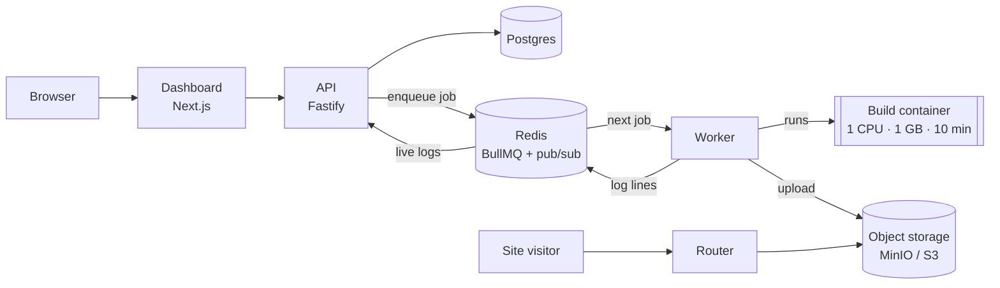

# Shipyard

**Paste a GitHub repo link and get a live website.** Shipyard is a self-hosted deploy platform, a small version of Vercel or Netlify built from scratch. It builds a site inside an isolated Docker container, streams the build logs live, and serves the result at `https://<project>.<domain>`.

It supports static sites and single-page apps: Vite, Create React App, plain HTML and Next.js static export.

> **Status:** Milestone 1 of 6 is complete: GitHub sign-in and project creation work end to end, with 50 passing tests. Builds, live logs and serving are next (see the [roadmap](#roadmap)).

## How it works

1. **Sign in** with GitHub on the dashboard.
2. **Add a project:** paste a repo URL and pick a name. The name becomes the site's subdomain.
3. **Deploy:** the API puts a build job on a queue instead of building right away.
4. **Build in isolation:** a worker clones the repo and builds it inside a throwaway Docker container with CPU, memory and time limits.
5. **Watch it live:** every build log line is streamed to the browser as it happens.
6. **Go live:** the built files are uploaded to object storage, and the project's "active deployment" pointer switches to the new build in one atomic update.
7. **Serve:** the router maps `my-site.<domain>` to that deployment's files.



More detail: [docs/architecture.md](docs/architecture.md) · design tradeoffs: [docs/decisions.md](docs/decisions.md)

## Tech stack

| Layer     | Technology                                                        |
| --------- | ----------------------------------------------------------------- |
| Language  | TypeScript (strict) everywhere                                    |
| Monorepo  | pnpm workspaces + Turborepo                                       |
| Dashboard | Next.js 16 (App Router), Tailwind CSS, shadcn/ui-style components |
| API       | Fastify 5, zod validation                                         |
| Database  | PostgreSQL + Prisma 7                                             |
| Auth      | Auth.js (GitHub OAuth)                                            |
| Queue     | BullMQ on Redis                                                   |
| Builds    | Worker using `dockerode` to run Docker containers                 |
| Storage   | MinIO locally, S3 / Cloudflare R2 in production                   |
| Testing   | Vitest (unit + API integration), Playwright (planned)             |
| CI        | GitHub Actions: lint, typecheck, test                             |

## Design highlights

- **Untrusted code stays in a box.** Builds run in throwaway containers as a non-root user, with resource limits, no Docker socket and no secrets.
- **Only the API touches the database.** The dashboard calls the API, which decrypts the same Auth.js session cookie using a shared secret.
- **One validation source.** The same zod schemas check the form in the browser and the request in the API.
- **No shell injection.** Build commands are rejected if they contain shell operators (`&&`, `|`, `;`, `$`), and they run as argument arrays.
- **Instant rollback.** Going live is a single-row pointer switch, so rolling back is the same switch pointed at an older build.
- **Backpressure.** A burst of deploys waits in the queue instead of overloading the server.

## Project structure

```
apps/
  web/        Next.js dashboard
  api/        Fastify REST API (+ WebSocket logs in M3)
  worker/     Docker build runner (M2)
  router/     Subdomain reverse proxy (M4)
packages/
  db/         Prisma schema, migrations, client
  shared/     zod schemas, types, constants
  config/     tsconfig, ESLint, Prettier presets
docs/         architecture and decision log
```

## Run it locally

**Prerequisites:** Node 22+, pnpm 10, Docker Desktop.

1. **Create a GitHub OAuth app** at <https://github.com/settings/developers>:
   - Homepage URL: `http://localhost:3000`
   - Callback / redirect URL: `http://localhost:3000/api/auth/callback/github`
2. **Configure environment:** copy `.env.example` to `.env` and fill in `AUTH_SECRET`, `AUTH_GITHUB_ID` and `AUTH_GITHUB_SECRET`. `.env` is gitignored; never commit it.
3. **Start:**

   ```sh
   pnpm install
   docker compose up -d   # Postgres (port 5433), Redis, MinIO
   pnpm db:migrate        # create the database tables
   pnpm dev               # dashboard on :3000, API on :4000
   ```

4. Open <http://localhost:3000> and sign in.

| Command                        | What it does                                              |
| ------------------------------ | --------------------------------------------------------- |
| `pnpm dev`                     | Run all apps in watch mode                                |
| `pnpm test`                    | Unit tests + API integration tests (needs Docker running) |
| `pnpm lint` / `pnpm typecheck` | ESLint and TypeScript checks                              |
| `pnpm db:migrate`              | Apply database migrations                                 |

## Roadmap

- [x] **M1 Skeleton:** monorepo, Docker Compose, Prisma schema, GitHub login, create project
- [ ] **M2 Builds:** queue + worker + Docker build, status updates
- [ ] **M3 Live logs:** Redis Pub/Sub → WebSocket → log viewer
- [ ] **M4 Serving:** upload to MinIO, router serves `<slug>.localhost`
- [ ] **M5 Polish:** deployment history, one-click rollback, build cancellation, framework auto-detect
- [ ] **M6 Prove it:** k6 load test numbers, GitHub webhook auto-deploy

_Demo video and load-test numbers will be added as the milestones land._
